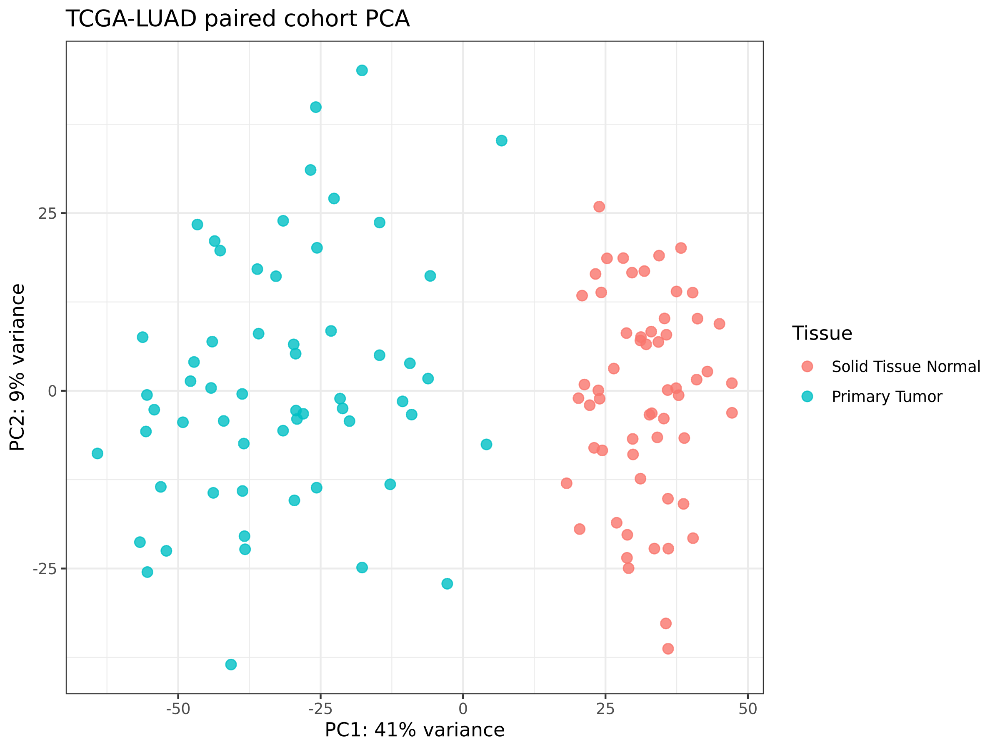
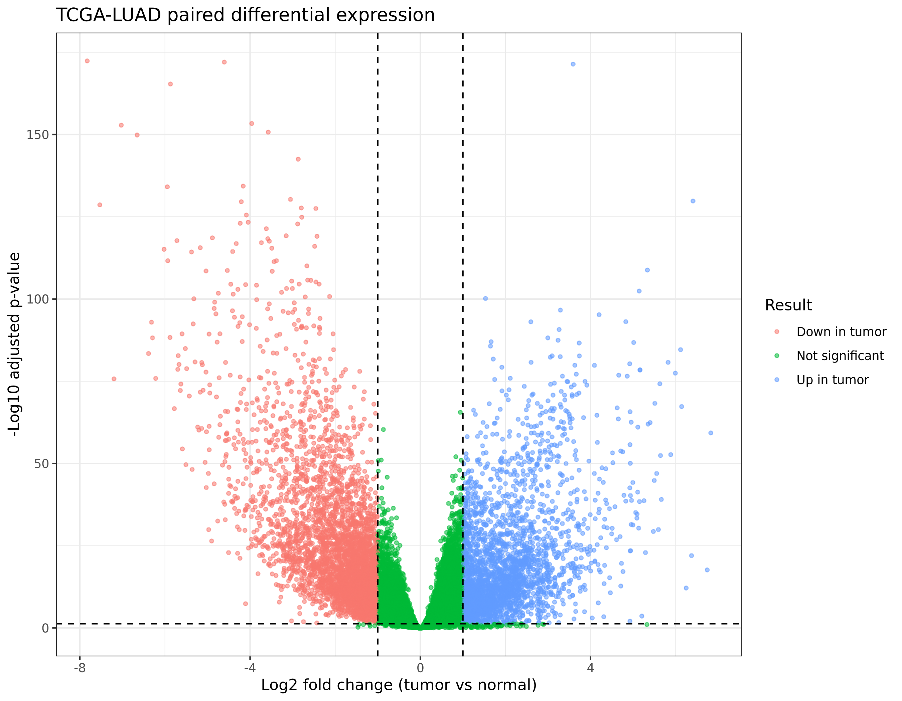
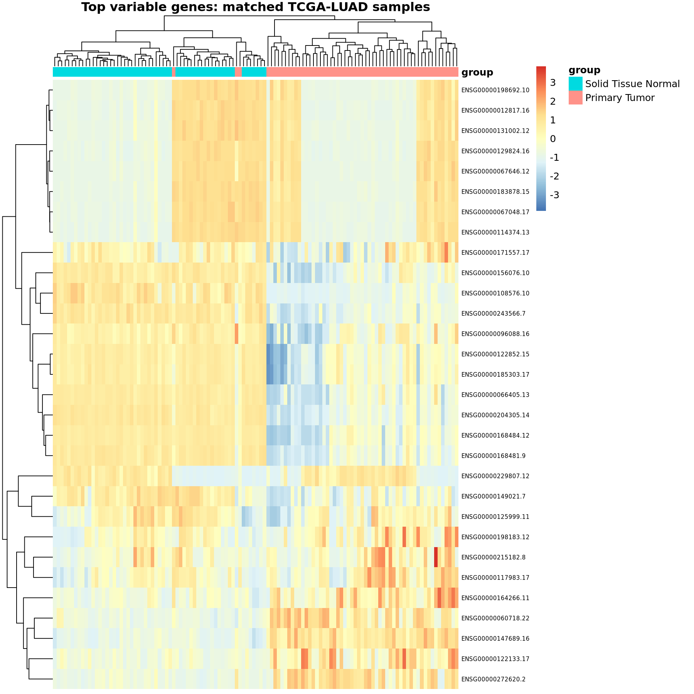
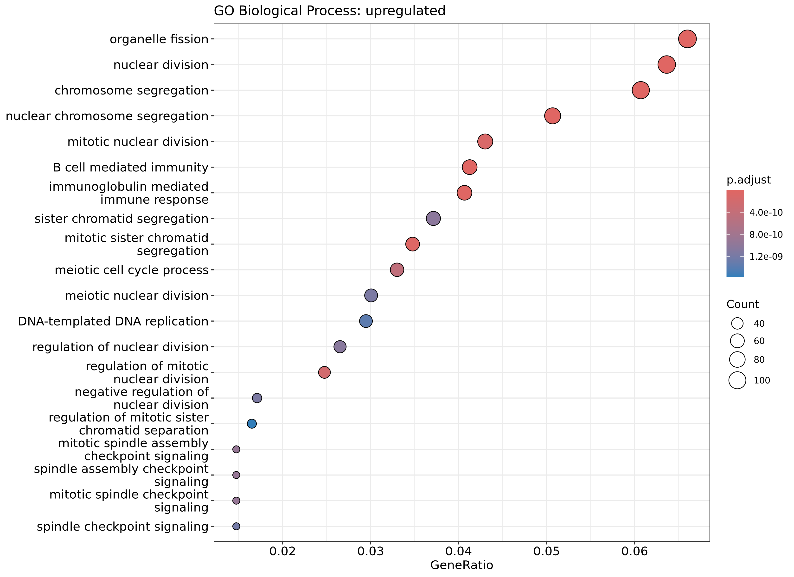
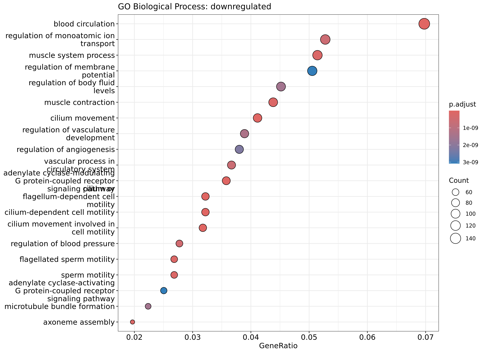
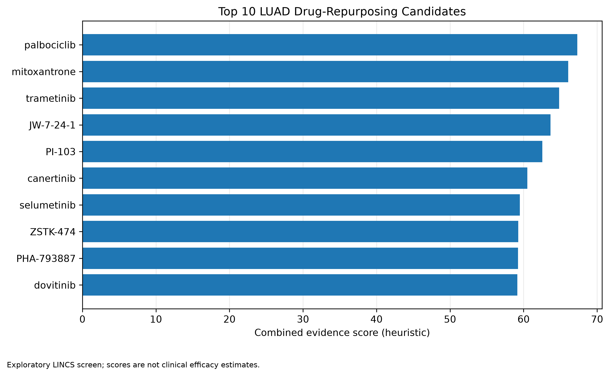

# Integrated Drug Repurposing in Lung Adenocarcinoma (LUAD)

An exploratory bioinformatics project integrating tumor-versus-normal
RNA-seq analysis, pathway enrichment, drug perturbation signatures,
candidate prioritization, and molecular docking.

## Objectives

- Identify differentially expressed genes in LUAD.
- Investigate enriched biological processes.
- Screen LINCS L1000 perturbation signatures for potential expression reversal.
- Prioritize candidate compounds for further study.
- Explore selected drug–target interactions through molecular docking.

## Data and methods

### TCGA-LUAD

RNA-seq count data were obtained from the NCI Genomic Data Commons.
The initial cohort contained 540 primary tumors and 59 solid-tissue
normal samples. Patient-level selection retained one sample per patient
and tissue group. Differential expression was then assessed in 58
patients with matched tumor and normal samples using DESeq2.

### Pathway and drug-signature analysis

Gene Ontology biological-process enrichment and ranked gene-set
enrichment were performed. LINCS L1000 chemical-perturbation libraries
were explored using Enrichr to identify candidate compounds for follow-up.
This is an exploratory enrichment screen, not a formal Connectivity Map
connectivity-score analysis.

### Molecular docking

Palbociclib was redocked into its crystallographic CDK6 complex to assess
pose recovery, then explored in a CDK4 structure. Docking scores and
predicted poses are computational evidence only; they do not establish
binding affinity, drug sensitivity, or clinical efficacy.

## Repository layout

- `scripts/` — analysis and workflow scripts
- `docs/` — methods and environment documentation
- `data/raw/` — downloaded source data (not tracked by Git)
- `data/processed/` — intermediate and docking files (not tracked by Git)
- `results/` — generated tables and figures (not tracked by Git)

## Reproducibility

The Conda environment specification is in `docs/conda-environment.yml`.
Docking details and limitations are documented in
`docs/molecular_docking_methods.md`. Run scripts from the project root
unless a script's comments specify otherwise.

## Limitations and next steps

The LINCS results are hypothesis-generating and may be influenced by
cell line, dose, exposure time, and shared proliferation signatures.
Docking scores are not proof of biological activity. Independent-cohort
validation and experimental follow-up remain necessary before drawing
strong conclusions.

## Visual results

### 1. TCGA-LUAD principal component analysis

### 2. Differential expression

### 3. Expression heatmap

### 4. Enriched biological processes

**Upregulated genes**

**Downregulated genes**

### 5. Drug-candidate prioritization

The candidate scores are heuristic and hypothesis-generating; they do not estimate clinical efficacy.
